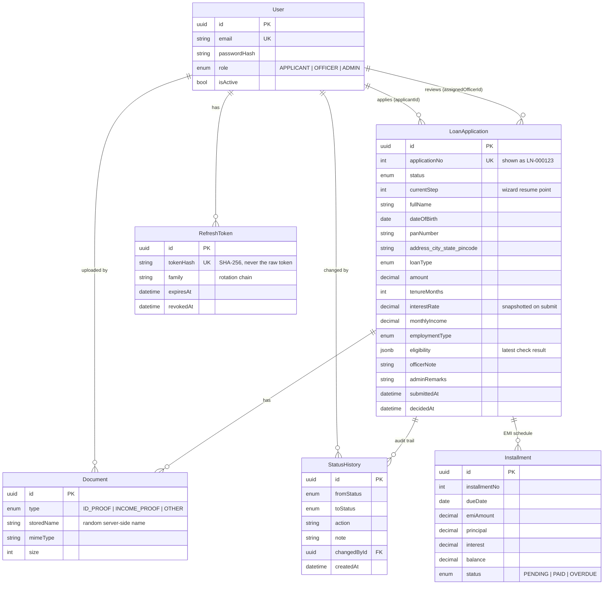

# LoanDesk — Loan Management System

A full-stack loan workflow: **applicants** apply and track their loans, **loan officers** review applications with a rule-based eligibility check, and **admins** make the final decision. Approved loans get an EMI repayment schedule automatically. Every status change is recorded in an audit trail.

**Live demo:** https://loandesk-8d16.onrender.com. It runs on Render's free tier, so the first request after a period of inactivity can take about 50 seconds while the server wakes up.

| | |
|---|---|
| **Frontend** | React 19 (Vite), Tailwind CSS v4, React Router, TanStack Query, React Hook Form + Zod |
| **Backend** | Node.js + Express, Prisma ORM, Zod validation, JWT (access + rotating refresh), Multer |
| **Database** | PostgreSQL |
| **Tests** | Vitest + Supertest (unit + full-lifecycle integration test against a real DB) |
| **Ops** | Dockerfile (single image), docker-compose (API + Postgres), Render blueprint |

**Demo accounts** (created by the seed script):

| Role | Email | Password |
|---|---|---|
| Applicant | `applicant@lms.test` | `Applicant@1234` |
| Loan Officer | `officer@lms.test` | `Officer@1234` |
| Admin | `admin@lms.test` | `Admin@1234` |

The login page also has one-click buttons that fill these in.

---

## Contents

1. [Running locally](#running-locally)
2. [Project structure](#project-structure)
3. [Why PostgreSQL](#why-postgresql)
4. [Data model](#data-model)
5. [Workflow and status transitions](#workflow-and-status-transitions)
6. [Eligibility rules](#eligibility-rules)
7. [EMI calculation](#emi-calculation)
8. [API reference](#api-reference)
9. [Security notes](#security-notes)
10. [Testing](#testing)
11. [Deployment](#deployment)
12. [Assumptions](#assumptions)
13. [Known limitations and what I'd do next](#known-limitations-and-what-id-do-next)

---

## Running locally

### Option A — Docker (one command)

```bash
docker compose up --build
# open http://localhost:4000
```

This starts PostgreSQL and the app. The container runs migrations and seeds the demo accounts on start. The API serves the built React app, so there is a single URL.

### Option B — Node + your own PostgreSQL (for development)

Requirements: Node 20+, PostgreSQL 14+.

```bash
# 1. Backend
cd backend
cp .env.example .env          # then set DATABASE_URL to your database
npm install                   # also runs `prisma generate`
npx prisma migrate deploy     # create tables
npm run db:seed               # demo users + two sample applications
npm run dev                   # API on http://localhost:4000

# 2. Frontend (new terminal)
cd frontend
npm install
npm run dev                   # http://localhost:5173 (proxies /api to :4000)
```

### Environment variables (backend)

| Variable | Default | Purpose |
|---|---|---|
| `DATABASE_URL` | — (required) | PostgreSQL connection string |
| `JWT_ACCESS_SECRET` | — (required) | Signs 15-minute access tokens |
| `JWT_REFRESH_SECRET` | — (required) | Reserved for refresh signing (refresh tokens are opaque random strings, stored hashed) |
| `ACCESS_TOKEN_TTL` | `15m` | Access token lifetime |
| `REFRESH_TOKEN_TTL_DAYS` | `7` | Refresh token lifetime |
| `CLIENT_ORIGIN` | `http://localhost:5173` | Comma-separated CORS allow-list |
| `UPLOAD_DIR` | `uploads` | Where uploaded documents are stored |
| `COOKIE_SAMESITE` | `lax` | Set to `none` if frontend and API are on different sites |
| `COOKIE_SECURE` | `true` in production | Set to `false` to test a production build over plain HTTP |
| `PORT` | `4000` | API port |

Frontend: `VITE_API_URL` (optional, default `/api/v1`). Only needed if the API is on a different origin.

---

## Project structure

```
correm-lms/
├── backend/
│   ├── prisma/
│   │   ├── schema.prisma          # data model
│   │   ├── migrations/            # SQL migrations
│   │   └── seed.js                # demo users + sample data
│   ├── src/
│   │   ├── config/                # env parsing, loan product catalogue + eligibility thresholds
│   │   ├── lib/
│   │   │   ├── emi.js             # EMI formula + amortisation schedule (pure)
│   │   │   ├── eligibility.js     # rule-based eligibility check (pure)
│   │   │   ├── workflow.js        # status state machine (pure)
│   │   │   ├── notifier.js        # email simulation
│   │   │   └── prisma.js
│   │   ├── middleware/            # auth/role guards, Zod validation, uploads, error handler
│   │   ├── modules/
│   │   │   ├── auth/              # register, login, refresh, logout, me
│   │   │   ├── users/             # admin user management
│   │   │   └── applications/      # schemas, service (business logic), routes, CSV/PDF export
│   │   ├── utils/                 # ApiError, pagination helpers
│   │   ├── app.js                 # Express app factory (used by server and tests)
│   │   └── server.js
│   └── tests/                     # unit + integration tests
├── frontend/
│   └── src/
│       ├── lib/                   # axios client with silent refresh, formatters, EMI mirror
│       ├── context/AuthContext.jsx
│       ├── hooks/queries.js       # TanStack Query hooks
│       ├── components/            # UI kit, layout, timeline, documents, schedule, details
│       └── pages/                 # auth, applicant/, staff/ (officer + admin), admin/
├── Dockerfile, docker-compose.yml, render.yaml
└── README.md
```

**Layering on the backend.** Routes do HTTP only: parse, validate, call a service, send a response. Services hold business logic and talk to Prisma. The parts with real logic (`emi.js`, `eligibility.js`, `workflow.js`) are **pure functions with no I/O**, which is why they can be unit-tested without a database.

---

## Why PostgreSQL

The domain is relational and depends on consistency:

- **Clear relationships with integrity.** Users ↔ applications ↔ documents ↔ status history ↔ installments. Foreign keys, cascades, and unique constraints (`(applicationId, installmentNo)`) are enforced by the database.
- **Transactions.** Approving a loan changes the status, writes an audit row and inserts the full EMI schedule. That has to be all-or-nothing, and Postgres transactions make it so.
- **Money.** `NUMERIC(14,2)` stores rupee amounts exactly. There's no floating-point drift in stored values.
- **Reporting queries.** Filtering by status, loan type and date range, plus `GROUP BY` stats for dashboards, are natural in SQL and backed by composite indexes.
- **Still flexible where it matters.** The eligibility result is a `JSONB` column, so the rule set can change without a migration.

MongoDB would work too, but I'd end up re-implementing relational integrity and multi-document transactions by hand.

---

## Data model



**Design decisions**

- **One application table across all stages.** The application's fields are nullable, so a draft can be saved partially. Completeness is enforced when the applicant **submits**, not when a row is inserted. That's what makes save-as-draft work.
- **Interest rate is snapshotted at submission.** If the product's rate changes later, an application already in the pipeline keeps the rate it was quoted.
- **`StatusHistory` is append-only.** It records who, when, from → to, the action, and the reason. It's the audit trail and also drives the applicant's timeline.
- **Indexes match the real queries:**
  - `(applicantId, status)` for the applicant dashboard
  - `(status, submittedAt)` for the officer/admin queues
  - `(loanType, status)` for filtering
  - `(applicationId, createdAt)` for the history
  - `(status, dueDate)` on installments, for future overdue jobs

---

## Workflow and status transitions

All transitions go through **one endpoint**, `POST /applications/:id/actions` with `{ action, note }`, backed by a state machine in [`backend/src/lib/workflow.js`](backend/src/lib/workflow.js). The state machine is the single source of truth for which role can take which action from which status. The UI asks the server for `availableActions`, so the buttons can never get out of sync with the rules.

```
DRAFT ──SUBMIT──▶ SUBMITTED ──START_REVIEW──▶ UNDER_REVIEW ──REQUEST_INFO──▶ MORE_INFO_NEEDED
                      ▲                          │                                │
                      └──────────── RESPOND ─────┼────────────────────────────────┘
                                                 │ RECOMMEND_APPROVAL / RECOMMEND_REJECTION
                                                 ▼
                         RECOMMENDED_APPROVAL / RECOMMENDED_REJECTION
                                   │ APPROVE / REJECT (admin)      │ RETURN_TO_OFFICER (admin)
                                   ▼                               └──▶ UNDER_REVIEW
                            APPROVED / REJECTED  (terminal)
```

| Action | From | To | Who | Note required |
|---|---|---|---|---|
| `SUBMIT` | DRAFT | SUBMITTED | Applicant (owner) | — |
| `START_REVIEW` | SUBMITTED | UNDER_REVIEW | Officer / Admin (claims it) | — |
| `REQUEST_INFO` | UNDER_REVIEW | MORE_INFO_NEEDED | Assigned officer | ✔ (shown to applicant) |
| `RESPOND` | MORE_INFO_NEEDED | SUBMITTED | Applicant (owner) | ✔ |
| `RECOMMEND_APPROVAL` / `_REJECTION` | UNDER_REVIEW | RECOMMENDED_* | Assigned officer, **after running eligibility** | ✔ |
| `APPROVE` / `REJECT` | RECOMMENDED_* | APPROVED / REJECTED | Admin | ✔ |
| `RETURN_TO_OFFICER` | RECOMMENDED_* | UNDER_REVIEW | Admin | ✔ |

Guarantees:

- **Atomic.** Status update, audit row and (on approval) the EMI schedule are written in one transaction.
- **Race-safe.** The update is conditional on the expected current status (`UPDATE … WHERE status = <expected>`). Two admins clicking "approve" at the same time get one success and one **409 Conflict**. A double approval can't create two schedules.
- **Ownership.** Only the officer who claimed a review can act on it.
- **Applicant privacy.** Applicants see `RECOMMENDED_*` simply as "Under review". Internal officer and admin notes and the eligibility details are hidden from them. They do see the info request, their own responses, and the final remarks.
- **Notifications.** Every transition triggers a simulated email (logged to the console as `📧 [mail] …`) in [`notifier.js`](backend/src/lib/notifier.js). It's built to be swapped for Nodemailer, SES or Mailtrap.

---

## Eligibility rules

[`backend/src/lib/eligibility.js`](backend/src/lib/eligibility.js) is a deterministic pure function. It returns a pass/fail for each rule plus an overall result. The officer runs it from the review screen, and the result (with who ran it and when) is stored on the application. **An officer can't make a recommendation until the check has been run.** The check is advisory: an officer can still recommend approval of a failing application, with a written justification, and the admin can see both.

| # | Rule | Threshold | Why |
|---|---|---|---|
| 1 | **Age** | 21 – 60 years on the application date | Typical lending age band |
| 2 | **Age at maturity** | age + tenure (years) ≤ 70 | Loan should end before retirement-age risk |
| 3 | **PAN format** | `AAAAA9999A` | Basic KYC sanity |
| 4 | **Employment** | not `UNEMPLOYED` | Needs a source of income |
| 5 | **Minimum income** | monthly income ≥ ₹15,000 | Floor for any unsecured lending |
| 6 | **Loan-to-income** | amount ≤ *k* × annual income; *k* = Personal 2, Vehicle 3, Business 3, Home 6 | Caps total exposure relative to earnings (secured home loans allow more) |
| 7 | **FOIR / affordability** | EMI ≤ 50% of monthly income | Fixed-obligation-to-income ratio used by Indian lenders |
| 8 | **Product limits** | amount and tenure within the loan type's min/max | Product policy |
| 9 | **Documents** | ID proof **and** income proof uploaded | Completeness |

All thresholds live in [`config/loanProducts.js`](backend/src/config/loanProducts.js), so policy changes don't touch the logic.

**Loan products (fixed sample rates):**

| Type | Rate p.a. | Amount | Tenure |
|---|---|---|---|
| Personal | 12.5% | ₹10k – ₹25L | 6 – 60 months |
| Home | 8.5% | ₹3L – ₹5Cr | 12 – 360 months |
| Vehicle | 9.5% | ₹50k – ₹50L | 12 – 84 months |
| Business | 14% | ₹1L – ₹1Cr | 12 – 120 months |

---

## EMI calculation

Standard reducing-balance formula ([`lib/emi.js`](backend/src/lib/emi.js)):

```
EMI = P × r × (1 + r)^n / ((1 + r)^n − 1)      r = annual% / 12 / 100,  n = months
```

- The schedule starts one month after approval. Due dates clamp to the end of the month, so 31 Jan → 28/29 Feb.
- Each month: `interest = round(balance × r)`, `principal = EMI − interest`.
- The **last instalment absorbs the rounding drift**, so the closing balance is exactly ₹0.00 and the principal parts add up to exactly the loan amount (both are unit-tested).
- If `r = 0`, the EMI is `P / n`.
- The frontend has a mirror of the same function for the **live EMI preview** in the form. Because both use the same rounding, the preview matches the final schedule to the paisa.

Checked against textbook values: ₹1,00,000 @ 12% for 12 months = **₹8,884.88**; ₹10,00,000 @ 8.5% for 240 months = **₹8,678.23**.

---

## API reference

Base URL `/api/v1`. JSON throughout. Errors always look like this:

```json
{ "error": { "status": 422, "message": "Application is incomplete", "details": [{ "path": "documents", "message": "INCOME_PROOF document is required" }] } }
```

Status codes used: `200`, `201`, `204`, `400` (validation), `401` (not authenticated or expired token), `403` (wrong role or not the owner), `404` (also used for resources you aren't allowed to see, so IDs don't leak), `409` (invalid transition or concurrent change), `413` (file too large), `422` (incomplete application or missing eligibility check), `429` (rate limited).

| Method | Path | Role | Notes |
|---|---|---|---|
| POST | `/auth/register` | public | Creates an **applicant**. Rate limited. |
| POST | `/auth/login` | public | Rate limited (10 per 15 min per IP) |
| POST | `/auth/refresh` | cookie | Rotates the refresh token |
| POST | `/auth/logout` | cookie | Revokes the refresh token |
| GET | `/auth/me` | any | |
| GET | `/users` | admin | `?page&limit&role=OFFICER,ADMIN&q&isActive` |
| POST | `/users` | admin | Create a staff or applicant account |
| PATCH | `/users/:id` | admin | Change role, activate or deactivate (deactivating revokes sessions) |
| GET | `/loan-products` | public | Rates and limits |
| POST | `/emi/preview` | public | `{loanType, amount, tenureMonths}` |
| GET | `/applications` | any (scoped) | `?page&limit&status=A,B&loanType=A,B&from&to&q&assigned=me\|unassigned&sort&order` |
| GET | `/applications/stats` | any (scoped) | Counts by status for dashboards |
| POST | `/applications` | applicant | Create a draft |
| GET | `/applications/:id` | owner / staff | Includes documents, history, installments, `availableActions` |
| PATCH | `/applications/:id` | owner | Partial save (DRAFT or MORE_INFO_NEEDED only) |
| DELETE | `/applications/:id` | owner | Drafts only |
| POST | `/applications/:id/actions` | depends on action | `{action, note}`; see the state machine |
| POST | `/applications/:id/eligibility` | officer / admin | Runs and stores the check |
| POST | `/applications/:id/documents` | owner | multipart: `type`, `file` (PDF/JPG/PNG/WEBP, ≤ 5 MB) |
| GET | `/documents/:id/file` | owner / staff | Streams the file (auth-checked) |
| DELETE | `/documents/:id` | owner | Drafts only. After submission, documents are part of the record. |
| GET | `/applications/:id/schedule` | owner / staff | EMI table + summary |
| PATCH | `/applications/:id/schedule/:no` | admin | `{status: PAID\|OVERDUE\|PENDING}` |
| GET | `/applications/:id/export?format=pdf\|csv` | owner / staff | Loan summary + schedule |

**Row-level scoping on lists:** applicants only see their own applications. Officers see everything except other people's drafts. Admins see everything.

---

## Security notes

- Passwords are hashed with **bcrypt** (cost 12). Login always runs a bcrypt compare, even for unknown emails, so response timing doesn't reveal which accounts exist.
- **Access token:** a 15-minute JWT kept **in memory only** in the SPA (not in localStorage).
- **Refresh token:** an opaque random value in an `httpOnly` cookie scoped to `/api/v1/auth`. Only its SHA-256 hash is stored. It's **rotated on every use**. Re-using a rotated token revokes its whole family (theft detection). There's a 30-second grace window so a reload or a second tab during a refresh doesn't log the user out.
- The access token's user is re-read from the database on every request, so a deactivated user is locked out immediately.
- **Uploads:** the MIME type is checked against an allow-list *and* the file's magic bytes are verified, so a renamed `.exe` is rejected. Files get random server-side names. They're served only through an authorization-checked endpoint, with `nosniff`.
- CSV export neutralises spreadsheet formula injection (`=`, `+`, `-`, `@`).
- Also in place: Helmet headers, a CORS allow-list, a JSON body size limit, and rate limits on auth endpoints.

---

## Testing

```bash
cd backend
# needs a separate test database; see .env.test (DATABASE_URL=…/lms_test)
DATABASE_URL=postgresql://…/lms_test npx prisma migrate deploy
npm test
```

**33 tests** in two files:

- **`tests/unit.test.js`**: covers the EMI formula against textbook values, zero rate, invalid input, full amortisation (closing balance 0, principal adds up exactly), month-end due dates, every eligibility rule including birthday edge cases, and state machine permissions.
- **`tests/api.test.js`**: the full lifecycle over HTTP against a real Postgres database. Steps covered:
  1. Register, including weak-password and duplicate-email checks.
  2. Refresh rotation and reuse detection.
  3. Role guards.
  4. Draft save and PAN normalisation.
  5. Officers can't see drafts.
  6. Submit is blocked without documents; fake-PDF uploads are rejected.
  7. Upload, then submit.
  8. Queue filters and pagination.
  9. Officer ownership: a second officer is blocked.
  10. Request info, then the applicant responds.
  11. A recommendation is blocked until eligibility has run.
  12. Applicant view hides internal data.
  13. Officers can't approve; the admin approves.
  14. A second approval returns 409.
  15. The 24-row schedule ends at balance 0.
  16. The admin marks an EMI paid.
  17. The exact audit trail sequence is recorded.
  18. CSV export, plus 404s for other users.

---

## Deployment

The repo deploys as **one Docker service**: the API serves the built SPA, so there's a single origin, no CORS problems, and first-party cookies.

**Render (blueprint included, no Docker needed):** New → Blueprint → select this repo. `render.yaml` creates a Node web service and a free PostgreSQL database, and generates the JWT secrets. It uses the root `package.json` scripts:

- `npm run build`: builds the React app and installs the API's dependencies.
- `npm start`: runs `prisma migrate deploy` and the idempotent seed, then starts Express, which serves both the API and the SPA.

The same two commands work on any Node host (Railway, Fly, a VM). The Dockerfile is an alternative for container hosts.

**Split hosting** (e.g. Vercel frontend + Render API): set `VITE_API_URL=https://<api>/api/v1` on the frontend, and on the API set `CLIENT_ORIGIN=https://<frontend>` and `COOKIE_SAMESITE=none`.

---

## Assumptions

- **Registration** only creates applicants. Officer and admin accounts are created by an admin, or by the seed script.
- **Rates** are fixed per loan type and snapshotted at submission. Processing fees, taxes and credit score are out of scope.
- **EMI schedule** starts one month after the approval date. Disbursement date = approval date.
- **Officer assignment:** an officer **claims** an application by starting the review. Only that officer can recommend on it. Admins can also start reviews and request info.
- **Final decision:** the admin can approve a "recommended for rejection" application (or the reverse), as long as they write remarks. The officer's recommendation is advice, not a veto.
- **After submission:** documents can't be deleted, only added (in response to an info request). This keeps the record intact.
- **Applicants see a simplified status.** They don't see the internal "recommended" stage, the eligibility details, or internal notes.
- **Monetary values** are INR. Amounts are capped at ₹10 Cr by validation.

---

## Known limitations and what I'd do next

- **File storage is local disk.** On free hosting (e.g. Render free tier) the disk is ephemeral, so uploads disappear on redeploy. Next step: an S3/R2/Cloudinary storage adapter behind the same interface, serving files through signed URLs.
- **Overdue status is manual.** The admin marks EMIs as overdue; the UI only highlights past-due rows. Next: a daily job that flips `PENDING` → `OVERDUE` (the `(status, dueDate)` index is already there) and sends reminder emails.
- **Emails are simulated** (console log). Next: Nodemailer + Mailtrap/SES, with a `Notification` table for in-app notifications.
- **No password reset or email verification.**
- **The eligibility check is rule-based only.** No credit bureau data. A real system would version the rule set and store which version produced each result.
- **Frontend tests:** none yet. Next: Playwright for the three-role happy path, and React Testing Library for the wizard.
- **Bundle splitting:** routes are not lazy-loaded yet (one ~500 KB JS bundle).
- **Repayments:** prepayment, partial payment, and recomputing the schedule after a missed EMI aren't modelled.
- **Observability:** request IDs and structured logging (pino), plus OpenAPI docs generated from the Zod schemas.
